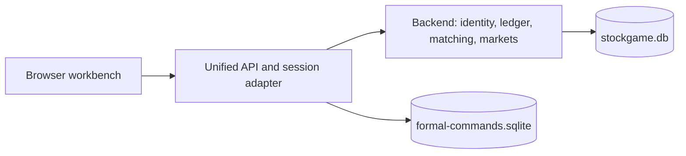

**English** | [中文](README.zh.md)

> Audit: 2026-10-29. Backend, Go API, both frontends, and synthetic browser checks were exercised. Production health was checked without player actions. The dependency audit reports zero critical/high packages in the three lockfiles; moderate/low findings remain. See [security findings and validation](docs/SECURITY-AUDIT-20261029.md).

# StockGame Online Pro

A multiplayer stock-trading simulation with persistent accounts, three market realms, AI opponents, and a chart-focused trading workbench.

**[Play online](https://game.bobbycn.cc/)** · [Changelog](CHANGELOG.md) · [License](LICENSE)

[](https://github.com/bobbychina32747/StockGameOnlinePro/releases)
[](LICENSE)

> **Beta.** Companies, prices, and funds are simulated. Orders never reach a real exchange.

## What you can do

- Trade a base catalog of **414 fictional stocks**: China, Hong Kong, and US realms, each with **23 sectors and six stocks per sector**. IPOs can expand the catalog.
- Read one-minute, five-minute, hourly, daily, weekly, and monthly candles with MA, BOLL, and RSI indicators. Adjust historical prices, zoom, and replay chart history.
- Submit market, limit, stop, stop-limit, FOK, IOC, and iceberg orders. Track partial fills, positions, pending orders, and executions.
- Explore earnings, consensus surprises, dividends, macro releases, sector cycles, news, and order flow.
- Use funds and margin, and short stocks where the realm permits it.
- Compete in seasons, compare AI opponents, review performance, and test MA crossover, RSI reversal, and momentum strategies.
- Run a reproducible microstructure experiment: compare lump orders, TWAP, and an expected-volume VWAP schedule against a no-parent-order baseline with finite liquidity, delayed information, and inventory-sensitive market makers.
- Use the workbench on desktop or mobile, with English, Simplified Chinese, or Traditional Chinese and dark/light themes.

The unified workbench uses the original backend as its authoritative ledger and matching engine. It does not maintain a second set of production assets.

## Accounts and market rules

Sign in with a game username/password or a linked site account. Choose a realm when entering the game. Each account supports at most one character per realm; a character cannot change realm. Realm assets are separate, and cross-realm trading and transfers are blocked.

| Realm | Base stocks | Selling | Short selling | Daily price limits | Minutes per simulated day |
| --- | ---: | --- | --- | --- | ---: |
| China (`CN`) | 138 | T+1: shares bought today can be sold the next game day | No | Normally ±10%; IPO rules can differ | 240 |
| Hong Kong (`HK`) | 138 | T+0 | Yes | No daily band | 330 |
| United States (`US`) | 138 | T+0 | Yes | No daily band | 390 |

New characters start with **100,000 units of their realm's simulated currency**. Commissions, taxes, borrowing costs, collateral, and liquidation checks are game rules calculated by the backend, not a statement of current brokerage or exchange requirements.

The hosted game follows real exchange dates and sessions: CN 09:30–11:30 / 13:00–15:00 (China time), HK 09:30–12:00 / 13:00–16:00 (Hong Kong time), and US 09:30–16:00 (New York time). Weekends, configured exchange holidays, 2026 half-day closures, and US daylight saving apply. New candles use actual timestamps; existing simulated history is preserved. Internal trading-day counters remain separate for settlement. Continuous or accelerated replay is an explicit development mode.

“Remember me” keeps the selected realm signed in for up to **7 days**. The browser uses an HttpOnly role cookie; the Secure attribute is added when `REMASTER_COOKIE_SECURE=true`. Local HTTP and hosted HTTPS therefore have different settings. The remember-me mechanism does not save the password. Remembered roles survive adapter restarts; signing out revokes that role session immediately. Site login remains subject to the parent site session being valid.

## Market simulation

Prices combine sector-calibrated stochastic returns, conditional volatility, heavy-tailed shocks, overnight gaps, bounded valuation drift, macro factors, news, and execution impact. China price limits apply to the resulting quotes. Volume responds to absolute price moves, persistent activity, sector parameters, and market-specific intraday patterns.

One-minute data feeds recent five-minute aggregation. News and executions update price, volume, traded value, and candle state. Simulated intrabar extrema produce candle shadows within the price boundaries. Market and AI snapshots retain the clock, cash, positions, costs, and activity state across backend restarts.

AI opponents run local rule strategies and a decision-stump ensemble. They have cash and position constraints, exposure limits, cooldowns, and drawdown controls. Their displayed returns come from simulated assets and executions; profitability is not guaranteed. Backtest results are independent simulations and do not change player account returns.

### Controlled market experiments

Open **Research → Market microstructure laboratory**. Choose a seed, target size and side, then run all four policies under the same external random signals. Adjust quote depth, replenishment, public information delay, informed accounts, inventory aversion, and a synthetic news shock. Charts expose price paths, spread, depth, event OFI, volume, paired impact, and role-level markouts. Execution reports include fill rates, fees, and the opportunity cost of unfilled shares.

The laboratory uses separate synthetic accounts in a browser worker. Its continuous, single-asset, T+0, long-only market has integer-cent accounting, reserved cash/shares, price-time priority, self-trade prevention, and **no unlimited liquidity fallback**. It does not place live orders or change player balances. Export the versioned JSON event log and import it to mechanically replay the ledger and verify SHA-256 checksums. A checksum checks content consistency, not authorship.

The lab is a controlled teaching model, **not a replacement for the hosted price generator or a calibrated Level 2 simulator**. Latent value remains exogenous; only order-book matches create trade prices. Market making uses an inventory heuristic rather than an optimal-control solution. VWAP uses an ex-ante expected-volume profile, and a single seed does not establish a real-market law. See [the model, metric definitions, and replay contract](docs/MICROSTRUCTURE-LAB.md).

### Data and validation

Calibration research includes **350,111 daily bars**, **173,865 five-minute bars**, **95,314 China traded-value/turnover records**, and **24,546 macro observations**. Production loads compact parameter files; raw collected data and player databases are not included in the repository.

- Volume-seasonality holdout tests improved for **68 of 69** reference stocks, with about **57% lower median error**. This measures intraday volume shape, not trading profitability.
- Intraday conditional-variance fitting improved holdout loss over a constant-variance baseline for **65 of 69** sector/market groups.
- The isolated price-volume mechanism comparison did **not** improve overall volume/absolute-return correlation. The full results include this limitation.

See the [price-volume study](docs/MARKET-MICROSTRUCTURE-20261012.md), [realism audit](docs/REALISM-AUDIT-20261013.md), and [full-market regression results](docs/REALISM-MARKET-REGRESSION-20261013.json).

Historical Level 2 depth, calibrated price-level memory, and sector-specific jump-event rates remain incomplete. Candle shadows are simulated quote ranges, not reconstructed real intrabar trades. This is a market simulation, not a verified replica or a forecasting system.

## Run locally

Use a maintained Node.js LTS compatible with the lockfiles. Node 22 and 24 remain LTS at this review date; check the [release schedule](https://nodejs.org/en/about/previous-releases) before a later upgrade. SQLite uses native `better-sqlite3` bindings; reinstall dependencies if you change Node versions.

### 1. Configure and start the backend

From the repository root, copy `backend/.env.example` to `backend/.env` only for a new local setup; preserve an existing configuration. Run backend commands from `backend/`, because its environment file is resolved from the working directory. Set your own `JWT_SECRET`, `JWT_REFRESH_SECRET`, and `ADMIN_PASSWORD`; do not use the example placeholders or production credentials.

For local exchange-calendar operation, use these settings:

```dotenv
NODE_ENV=development
DB_TYPE=sqlite
DB_SYNCHRONIZE=true
PORT=8000
TICK_INTERVAL_MS=60000
SANDBOX_FAST=false
FORMAL_CONTINUOUS_SIMULATION=false
```

`DB_SYNCHRONIZE=true` initializes a local development database. Manage production schema changes through reviewed migrations instead.

```bash
cd backend
npm ci
npm run build
npm start
```

First startup generates historical data and can take several minutes. Later starts restore persisted history and runtime state.

### 2. Build and start the unified workbench

In another terminal, from the repository root:

```bash
cd remaster
npm ci
npm run build
npm run start:formal
```

Open **[http://127.0.0.1:8321](http://127.0.0.1:8321)**. Select **Game account**, register, and choose a realm. The adapter connects to the backend at `http://127.0.0.1:8000` by default. Site-account login requires a configured identity service and trusted origins; it is not an automatic local SSO setup.

### Verify the first local session

Keep both service terminals running. Open `http://127.0.0.1:8321/api/v2/health`; expect `healthy: true` and `ledger: "legacy-authoritative"`. This checks that the adapter can reach the backend, not that every trade path works. Use the same host spelling consistently when opening the workbench and signing in.

Register a test game account, choose a realm and select a stock. Confirm the chart, cash and positions load. During an open simulated session, submit a small order within the displayed rules, then inspect its status and any execution or position change. A pending limit order is not a failed application; a closed market is not expected to fill immediately. Refresh and confirm the account and realm remain consistent. Use a separate local database when experimenting with replay or resets.

`EADDRINUSE`: identify the process using the port or choose another free port and update dependent settings. `healthy` fails: inspect the backend terminal and `REMASTER_IDENTITY_URL`. An origin error: check the actual browser URL against `REMASTER_ALLOWED_ORIGINS`. Native SQLite binding errors: check Node compatibility and reinstall using the project lockfile. `npm ci` replaces `node_modules`; use it in the intended project directory. [npm ci reference](https://docs.npmjs.com/cli/v11/commands/npm-ci).

### Configuration reference

| Setting | Purpose |
| --- | --- |
| `SQLITE_PATH` | Backend ledger database; development default: `./data/stockgame.db` |
| `TICK_INTERVAL_MS` | Real milliseconds per trading minute; normal pace: `60000` |
| `SANDBOX_FAST` | Explicit opt-in for accelerated sandbox timing |
| `FORMAL_CONTINUOUS_SIMULATION` | Default `false`: real exchange sessions; `true` explicitly enables continuous development replay |
| `REMASTER_IDENTITY_URL` | Adapter's backend/auth service URL; default: `http://127.0.0.1:8000` |
| `REMASTER_PORT` | Unified service port; default: `8321` |
| `REMASTER_ALLOWED_ORIGINS` | Comma-separated trusted browser origins |
| `REMASTER_SITE_ORIGIN` | Origin used by the adapter's identity bridge |
| `REMASTER_COOKIE_SECURE` | Enable secure cookies for HTTPS deployments |
| `UNIFIED_COMMAND_DB` | Adapter's command-idempotency database path |

The built web app uses `/` by default. Set `REMASTER_WEB_BASE` before building if you need another base path. In PowerShell, use `$env:REMASTER_WEB_BASE='/'`.

## Architecture



| Path | Responsibility |
| --- | --- |
| `backend/` | NestJS backend: accounts, authentication, trading, market generation, risk, funds, and seasons |
| `remaster/apps/web/` | React/Vite/ECharts workbench |
| `remaster/apps/game-api/` | Production ledger adapter, realm sessions, REST commands, and Socket.IO snapshots |
| `remaster/packages/domain/` | Shared types, catalog, and standalone simulation components |
| `remaster/tooling/` | Build tools, catalog import, and research utilities |
| `frontend/` | Legacy frontend retained for compatibility; not the unified game's main entry point |
| `docs/` | Architecture notes, API documentation, research, migration, and verification reports |

The main stack is TypeScript, React, Vite, ECharts, NestJS, TypeORM, SQLite, and Socket.IO. The adapter's command database stores idempotency records; it is not a second asset ledger.

## API and strategy integration

Authenticated realm sessions expose:

| Interface | Purpose |
| --- | --- |
| `GET /api/v2/state` | Account and market snapshot |
| `GET /api/v2/history/:symbol?interval=1m` | Candle history for the current realm |
| `GET /api/v2/book/:symbol` | Visible order-book depth |
| `POST /api/v2/commands` | Trading and account commands with an `Idempotency-Key` |
| Socket.IO `/v2` | Live snapshots |

Requests remain subject to authentication, realm boundaries, funds, fees, and trading rules. See the [adapter controller](remaster/apps/game-api/unified-controller.ts) for the v2 contract and [API documentation](docs/API.md) for the backend API. The repository also includes [a bot example](backend/scripts/quant-bot.js) and [a backtest CLI](backend/scripts/backtest.js).

## Checks

```bash
# Backend
cd backend
npm run build
npm test -- --runInBand

# Unified workbench, continuing from backend/
cd ../remaster
npm run verify
```

Enable commit checks with `git config core.hooksPath .githooks`. Repository CI covers backend and legacy frontend checks; the unified workbench has its own build, typecheck, and test commands. Market regressions and research reports are documented under `docs/`.

## Deployment and data

[unified-compose.yml](remaster/deploy/unified-compose.yml) describes the hosted adapter. It assumes an existing backend and Docker network; review hostnames, trusted origins, HTTPS cookies, mounts, and network names for your deployment.

- Keep the backend ledger, its WAL/SHM files, and adapter command database on persistent storage. Back up consistently before migrations or resets.
- Use strong authentication secrets and an administrator password. Keep `.env`, credentials, player databases, and raw data out of Git.
- Keep frontend, adapter, and backend contracts compatible during updates.
- Prefer a verified migration over automatic production schema synchronization.

The documented public-beta reset on **2026-10-12** preserved accounts and realm IDs while clearing beta assets and market state. It was a deliberate reset, not normal restart behavior. See the [reset and rollback guide](docs/PUBLIC-BETA-RESET-20261012.md) and [unified architecture](docs/UNIFIED-FORMAL-20261011.md).

## License

[PolyForm Noncommercial License 1.0.0](LICENSE). Noncommercial use, modification, and redistribution must comply with the license. Commercial use requires separate authorization. Retain the required copyright and license notices.
