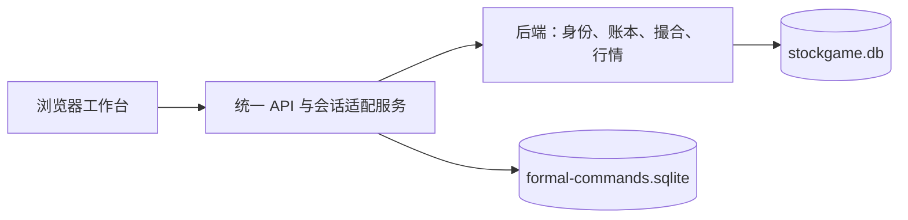

[English](README.md) | **中文**

# StockGame Online Pro

多人在线模拟炒股游戏，提供持久化账号、三个市场区服、AI 对手和以图表为中心的交易工作台。

**[在线游玩](https://game.bobbycn.cc/)** · [更新日志](CHANGELOG.md) · [许可证](LICENSE)

[](https://github.com/bobbychina32747/StockGameOnlinePro/releases)
[](LICENSE)

> **公测版本。** 公司、行情和资金均为模拟数据，订单不会进入真实交易所。

## 可以玩什么

- 交易 **414 支基础虚构股票**：中国、香港和美国三个区服，每区 **23 个行业，每行业六支股票**。IPO 可以扩充股票池。
- 查看一分钟、五分钟、小时、日、周、月蜡烛，使用 MA、BOLL、RSI 指标、复权、缩放和历史回放。
- 提交市价、限价、止损、止损限价、FOK、IOC 和冰山订单，查看部分成交、持仓、挂单和成交记录。
- 研究财报、预期差、分红、宏观发布、行业周期、新闻和订单流。
- 使用基金和融资，在允许的区服做空股票。
- 参加赛季、比较 AI 对手、复盘绩效，并回测均线交叉、RSI 反转和动量策略。
- 在电脑或手机上使用工作台，切换英文、简体中文、繁体中文以及深浅主题。

统一工作台以原后端作为唯一正式账本和撮合引擎，不另建一套正式资产。

## 账号与市场规则

使用游戏账密或已绑定的站点账号登录，进入游戏时选择区服。每个账号每区最多一个角色，角色不能修改区服。区服资产独立，不能跨区交易或划转。

| 区服 | 基础股票 | 卖出规则 | 做空 | 日涨跌停 | 每个模拟交易日的分钟数 |
| --- | ---: | --- | --- | --- | ---: |
| 中国（`CN`） | 138 | T+1：当日买入，下一游戏日可卖 | 不支持 | 普通股票 ±10%，IPO 可有特殊规则 | 240 |
| 香港（`HK`） | 138 | T+0 | 支持 | 无日涨跌停区间 | 330 |
| 美国（`US`） | 138 | T+0 | 支持 | 无日涨跌停区间 | 390 |

新角色获得 **100,000 单位区服模拟货币**。佣金、税费、借款成本、保证金和强平由后端按游戏规则计算，不代表现实券商或交易所的现行要求。

线上采用连续模拟：一个真实分钟推进一个交易分钟，现实休市期间也可运行。后端同时支持交易所日历模式及美股夏令时。两种模式的时钟不同，模拟交易日不等于现实日历日。

## 行情模拟

股价结合行业校准随机收益、条件波动率、厚尾冲击、隔夜缺口、有界估值漂移、宏观因素、新闻和成交冲击。中国区服对最终报价执行涨跌停限制。成交量随绝对价格变化、持续活跃度、行业参数和各市场盘中形态变化。

近期五分钟线由一分钟数据聚合。新闻和成交同步更新价格、成交量、成交额和蜡烛状态。受价格边界约束的盘中极值产生模拟影线。市场及 AI 快照保存时钟、现金、持仓、成本和活跃度，后端重启时恢复。

AI 对手使用本地规则策略和决策树桩集成，受现金、持仓、敞口、冷却和回撤约束。显示收益由模拟资产和实际撮合计算，不保证盈利。研究回测是独立模拟，不改变玩家账户收益。

### 数据与验证

校准研究包含 **350,111 条日线**、**173,865 条五分钟线**、**95,314 条中国市场成交额/换手率记录**及 **24,546 条宏观观测**。生产只加载汇总参数，原始采集数据和玩家数据库不进入仓库。

- 成交量盘中形态留出检验中，**69 支参考股票有 68 支改善**，误差中位数降低约 **57%**。这项检验衡量成交量形态，不衡量交易盈利。
- 盘中条件方差拟合在 **69 个行业/市场组合中有 65 个**优于恒定方差留出基线。
- 独立量价机制对照**没有提升成交量与绝对收益的整体相关**。报告保留了这一限制。

详见 [量价研究](docs/MARKET-MICROSTRUCTURE-20261012.md)、[真实性核对](docs/REALISM-AUDIT-20261013.md)和[完整市场回归](docs/REALISM-MARKET-REGRESSION-20261013.json)。

历史 Level 2 深度、经过校准的价位记忆和行业跳跃事件频率仍有缺口。影线是模拟报价范围，不是复原真实分钟成交路径。本项目是市场模拟，不是经过验证的真实市场副本或预测系统。

## 本地运行

使用 Node.js 22 或 24 和 npm。SQLite 依赖原生 `better-sqlite3` 绑定，切换 Node 版本后应重新安装依赖。

### 1. 配置并启动后端

在仓库根目录，将 `backend/.env.example` 复制为 `backend/.env`。自行设置 `JWT_SECRET`、`JWT_REFRESH_SECRET` 和 `ADMIN_PASSWORD`，不要沿用示例占位值或生产凭证。

本地连续模拟可以使用以下配置：

```dotenv
NODE_ENV=development
DB_TYPE=sqlite
DB_SYNCHRONIZE=true
PORT=8000
TICK_INTERVAL_MS=60000
SANDBOX_FAST=false
FORMAL_CONTINUOUS_SIMULATION=true
```

`DB_SYNCHRONIZE=true` 用于初始化本地开发数据库。生产表结构变更应使用经过审核的迁移。

```bash
cd backend
npm ci
npm run build
npm start
```

首次启动生成历史数据，可能需要数分钟。后续启动恢复已保存的历史和运行状态。

### 2. 构建并启动统一工作台

在另一个终端，从仓库根目录执行：

```bash
cd remaster
npm ci
npm run build
npm run start:formal
```

打开 **[http://127.0.0.1:8321](http://127.0.0.1:8321)**，选择“游戏账号”，注册并选择区服。适配服务默认连接 `http://127.0.0.1:8000` 的后端。站点登录需要配置身份服务和可信来源，不会自动完成本地 SSO 接入。

### 配置参考

| 配置项 | 用途 |
| --- | --- |
| `SQLITE_PATH` | 后端账本数据库，开发默认 `./data/stockgame.db` |
| `TICK_INTERVAL_MS` | 每个交易分钟对应的真实毫秒数，正常速度为 `60000` |
| `SANDBOX_FAST` | 显式允许沙盒加速时钟 |
| `FORMAL_CONTINUOUS_SIMULATION` | 允许正式引擎连续运行，不限于交易所时段 |
| `REMASTER_IDENTITY_URL` | 适配服务连接的后端/认证服务地址，默认 `http://127.0.0.1:8000` |
| `REMASTER_PORT` | 统一服务端口，默认 `8321` |
| `REMASTER_ALLOWED_ORIGINS` | 逗号分隔的可信浏览器来源 |
| `REMASTER_SITE_ORIGIN` | 适配服务身份桥使用的来源 |
| `REMASTER_COOKIE_SECURE` | HTTPS 部署时启用安全 Cookie |
| `UNIFIED_COMMAND_DB` | 适配服务命令幂等数据库路径 |

网页构建默认使用 `/`。需要其他路径时，在构建前设置 `REMASTER_WEB_BASE`。PowerShell 写法为 `$env:REMASTER_WEB_BASE='/'`。

## 架构



| 路径 | 职责 |
| --- | --- |
| `backend/` | NestJS 后端：账户、认证、交易、行情、风控、基金与赛季 |
| `remaster/apps/web/` | React/Vite/ECharts 工作台 |
| `remaster/apps/game-api/` | 正式账本适配、区服会话、REST 命令与 Socket.IO 快照 |
| `remaster/packages/domain/` | 共享类型、股票目录和独立模拟组件 |
| `remaster/tooling/` | 构建工具、目录导入和研究工具 |
| `frontend/` | 保留兼容用途的旧前端，不是统一游戏的主入口 |
| `docs/` | 架构、API、研究、迁移和验证报告 |

主要技术为 TypeScript、React、Vite、ECharts、NestJS、TypeORM、SQLite 和 Socket.IO。适配服务的命令数据库保存幂等记录，不是第二套资产账本。

## API 与策略接入

已认证区服会话可使用：

| 接口 | 用途 |
| --- | --- |
| `GET /api/v2/state` | 账户与行情快照 |
| `GET /api/v2/history/:symbol?interval=1m` | 当前区服标的的蜡烛历史 |
| `GET /api/v2/book/:symbol` | 可见盘口深度 |
| `POST /api/v2/commands` | 交易及账户命令，使用 `Idempotency-Key` |
| Socket.IO `/v2` | 实时快照 |

请求仍受认证、区服、资金、费用和交易规则约束。v2 契约见[适配控制器](remaster/apps/game-api/unified-controller.ts)，后端接口见 [API 文档](docs/API.md)。仓库另提供[机器人示例](backend/scripts/quant-bot.js)和[回测 CLI](backend/scripts/backtest.js)。

## 验证

```bash
# 后端
cd backend
npm run build
npm test -- --runInBand

# 统一工作台，从仓库根目录执行
cd remaster
npm run verify
```

执行 `git config core.hooksPath .githooks` 启用提交检查。仓库 CI 覆盖后端和旧前端检查；统一工作台提供自己的构建、类型检查和测试命令。市场回归及研究结果保存在 `docs/`。

## 部署与数据

[unified-compose.yml](remaster/deploy/unified-compose.yml)描述线上适配服务，依赖已有后端和 Docker 网络。部署到其他环境时，需要核对主机名、可信来源、HTTPS Cookie、挂载和网络名称。

- 后端账本及 WAL/SHM 文件、适配服务命令库使用持久存储，迁移或重置前保留一致的备份。
- 配置强认证密钥和管理员密码，不把 `.env`、凭证、玩家数据库或原始数据提交到 Git。
- 更新时保持前端、适配服务和后端契约兼容。
- 生产结构变更优先使用验证过的迁移，不依赖自动同步。

**2026-10-12** 的公测重置保留了账号和区服 ID，清空公测资产及行情状态。这是主动重置，不是正常重启行为。操作边界见[重置与回退说明](docs/PUBLIC-BETA-RESET-20261012.md)和[统一架构说明](docs/UNIFIED-FORMAL-20261011.md)。

## 许可证

[PolyForm Noncommercial License 1.0.0](LICENSE)。非商业使用、修改和再分发须遵守许可证，商业使用需要另行授权。保留必要的版权和许可声明。
